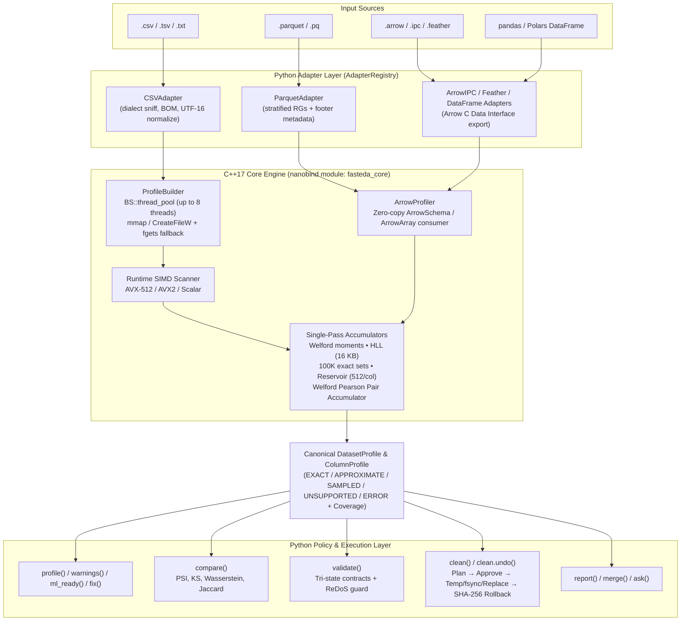
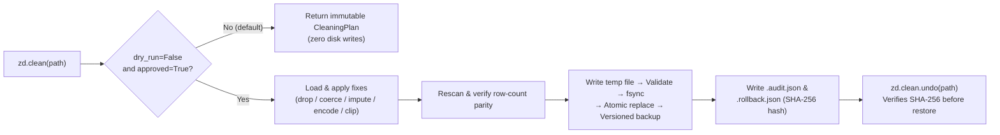

<div align="center">

<picture>
  <source media="(prefers-color-scheme: dark)" srcset="https://raw.githubusercontent.com/Zedda-Labs/Zedda/main/docs/logo-dark.png">
  <source media="(prefers-color-scheme: light)" srcset="https://raw.githubusercontent.com/Zedda-Labs/Zedda/main/docs/logo.png">
  
</picture>

<br>

**Zero-Effort Data Discovery & Analysis**

*C++17-powered data profiling, validation, drift detection, and transactional cleaning engine for Python.*

<p>
  <a href="https://pypi.org/project/zedda"></a>
  <a href="https://pypi.org/project/zedda"></a>
  <a href="https://pepy.tech/project/zedda"></a>
  <a href="https://github.com/Zedda-Labs/Zedda/actions/workflows/ci.yml"></a>
  <a href="https://github.com/Zedda-Labs/Zedda/actions/workflows/codeql.yml"></a>
  <a href="https://github.com/Zedda-Labs/Zedda/blob/main/LICENSE"></a>
</p>

<p>
  <a href="#quick-start"><b>Quick Start</b></a> ·
  <a href="#core-features"><b>Features</b></a> ·
  <a href="#architecture"><b>Architecture</b></a> ·
  <a href="#performance--benchmarks"><b>Benchmarks</b></a> ·
  <a href="#python-api-reference"><b>Python API</b></a> ·
  <a href="#cli-reference"><b>CLI</b></a> ·
  <a href="docs/API.md"><b>Full Docs</b></a>
</p>

</div>

---

## Overview

**Zedda** is a data profiling, contract validation, drift-detection, and safe data-cleaning library built on a multi-threaded **C++17 streaming core** with zero-copy **Python bindings** (`nanobind`).

Instead of loading entire multi-gigabyte files into Python memory before computing basic summary statistics, Zedda streams CSV files directly from OS memory-mapped buffers (`mmap` / `CreateFileMapping`) and streams Parquet, Arrow IPC, Feather, pandas, and Polars inputs over the **Arrow C Data Interface** into single-pass C++ accumulators.

### Key Highlights

- **C++17 Streaming Core + SIMD:** Multi-threaded CSV profiling (`BS::thread_pool`, up to 8 workers) with runtime-dispatched **AVX-512** / **AVX2** / scalar delimiter scanning and `fast_float` v8.0.0 number parsing.
- **Statistically Honest Provenance:** Every metric tracks whether it is `EXACT`, `APPROXIMATE`, `SAMPLED`, `UNSUPPORTED`, or `ERROR` along with row coverage (`rows_examined` / `rows_total`) and parse-error counts—no silent substitutions.
- **Constant Retained Memory on Large CSVs:** Single-pass Welford moments, HyperLogLog sketches (`~16 KB` per column), and packed upper-triangle Pearson correlation accumulators avoid full dataset materialization.
- **Zero-Runtime Native Dependencies for CSV:** Base `pip install zedda` only requires `rich` and `typer`; `pyarrow`, `pandas`, `scipy`, and `requests` are all optional extras.
- **Full Data-Quality Lifecycle:** Go from instant terminal EDA (`profile`), CI/CD data contracts (`validate`), train/test drift (`compare`), and ML-readiness scoring (`ml_ready`) to dry-run-first cleaning with SHA-256-verified rollback (`clean` / `clean.undo`) and self-contained offline HTML reports (`report`).

---

## Table of Contents

- [Quick Start](#quick-start)
- [Installation & Setup](#installation--setup)
- [Supported Platforms, Python Versions & Formats](#supported-platforms-python-versions--formats)
- [Architecture](#architecture)
- [Core Features](#core-features)
- [Python API Reference](#python-api-reference)
- [CLI Reference](#cli-reference)
- [Internal Technologies & Algorithms](#internal-technologies--algorithms)
- [Real-World Use Cases](#real-world-use-cases)
- [Performance & Benchmarks](#performance--benchmarks)
- [Configuration & Dependencies](#configuration--dependencies)
- [Limitations & Known Issues](#limitations--known-issues)
- [Troubleshooting & FAQ](#troubleshooting--faq)
- [Contributing, Security & Citation](#contributing-security--citation)

---

## Quick Start

```bash
pip install zedda
```

```python
import zedda as zd

# 1. Print a rich terminal EDA report (CSV works with zero extra dependencies)
zd.profile("data.csv")

# 2. Silent programmatic scan for pipelines & CI/CD
profile = zd.scan("data.csv")
print(f"{profile.num_rows:,} rows, {profile.num_cols} cols, {profile.overall_null_pct:.1f}% nulls")

# 3. Validate a data contract (CI/CD gate)
contract = zd.validate(
    "data.csv",
    rules={
        "age": {"min": 0, "max": 120, "max_null_pct": 5.0},
        "status": {"allowed_values": ["active", "inactive", "pending"]},
    },
)
assert contract.passed

# 4. Compare baseline vs incoming data for schema & distribution drift
zd.compare("train.csv", "test.csv")

# 5. Export a self-contained offline HTML report
zd.report("data.csv", output="report.html")
```

Every Python API function also accepts a `pandas.DataFrame` or `polars.DataFrame` (with `zedda[parquet]` installed for Arrow conversion).

---

## Installation & Setup

### Standard Installation (PyPI)

```bash
pip install --upgrade pip              # Ensure pip >= 22.3 for modern wheel resolution
pip install zedda                      # Base install: CSV/TSV/TXT profiling, validate, report, CLI
pip install "zedda[parquet]"           # Adds Parquet, Arrow IPC, Feather, and DataFrame support (pyarrow)
pip install "zedda[clean]"             # Adds dataset cleaning/fix execution (pandas, thefuzz)
pip install "zedda[merge]"             # Adds multi-file concatenation (pandas)
pip install "zedda[drift]"             # Adds SciPy Wasserstein distance in zd.compare() (scipy)
pip install "zedda[ai]"                # Adds LLM fallback for zd.ask() (requests)
pip install "zedda[parquet,clean,drift,ai]"  # Full feature set
```

### Conda Environments

Zedda is not yet published on `conda-forge` (a recipe is maintained in [`conda-recipe/meta.yaml`](conda-recipe/meta.yaml)). Install via `pip` inside your active conda environment:

```bash
conda activate myenv
pip install zedda
```

### High-Performance Native Source Builds (`x86-64-v3` / LTO)

Prebuilt PyPI wheels target generic 64-bit CPUs while keeping runtime `AVX2` / `AVX-512` dispatch inside the SIMD delimiter scanner (`src/core/simd_scanner.cpp`). To enable compiler auto-vectorization (`/arch:AVX2` / `-march=x86-64-v3`) and Link-Time Optimization (`LTO`) across the entire C++ engine on modern Intel Haswell+ / AMD Zen+ CPUs:

```bash
CMAKE_ARGS="-DZEDDA_TARGET_X86_64_V3=ON -DZEDDA_ENABLE_LTO=ON" pip install --no-binary zedda zedda
```

### Docker

A multi-stage [`Dockerfile`](Dockerfile) (Python 3.14-slim, non-root `zedda` user, `HEALTHCHECK` configured) is included in the repository:

```bash
docker build -t zedda .
docker run --rm -v "$(pwd):/data" zedda zedda profile /data/dataset.csv
```

### Build from Source (Contributors / Editable Install)

Requires a C++17 compiler (GCC 9+, Clang 10+, or MSVC 2019+), `cmake >= 3.21`, and `ninja`. The `--recursive` flag is required to pull `extern/nanobind`.

```bash
git clone https://github.com/Zedda-Labs/Zedda.git --recursive
cd Zedda
pip install cmake ninja scikit-build-core nanobind
pip install --no-build-isolation -e ".[dev]"
pytest tests/
```

---

## Supported Platforms, Python Versions & Formats

### Python & OS Support Matrix (Verified Against Release v0.4.9.1)

Zedda requires **Python `>=3.10, <3.15`**. Prebuilt wheels for `v0.4.9.1` (`30` platform wheels + `sdist`) are published on PyPI for:

| OS / Architecture | Python Versions | Base `zedda` | `zedda[parquet]` Extra | Notes |
| :--- | :---: | :---: | :---: | :--- |
| **Linux `x86_64`** (`manylinux_2_28`, `musllinux_1_2`) | `3.10` – `3.14` | Prebuilt wheel | Prebuilt `pyarrow` wheel | `mmap(..., MAP_POPULATE)` fast path |
| **Linux `aarch64`** (`manylinux_2_28`, `musllinux_1_2`) | `3.10` – `3.14` | Prebuilt wheel | Prebuilt `pyarrow` wheel | Scalar scanner fallback on ARM64 |
| **Windows `AMD64`** (`win_amd64`) | `3.10` – `3.14` | Prebuilt wheel | Prebuilt `pyarrow` wheel | `CreateFileW` + `MapViewOfFile` fast path |
| **macOS Apple Silicon** (`arm64`, macOS 11+) | `3.10` – `3.14` | Prebuilt wheel | Prebuilt `pyarrow` wheel | `mmap` + `madvise(MADV_SEQUENTIAL)` |
| **macOS Intel** (`x86_64`, macOS 10.14+) | `3.10` – `3.14` | Source build (`sdist`) | Prebuilt `pyarrow` wheel | Requires C++17 toolchain via Xcode CLT |
| **Windows `ARM64`** | `3.10` – `3.14` | Source build (`sdist`) | Manual `pyarrow` build | `pyarrow` has no `win_arm64` wheel |
| **Python 3.13t** (free-threaded) | `3.13t` | Not supported | Not supported | Use standard GIL-enabled Python 3.13 |

### Supported Input Formats

All input paths resolve through `AdapterRegistry` (`python/zedda/_adapters/registry.py`):

| Format | Extensions / Types | Adapter | Execution Path | Extra Required |
| :--- | :--- | :--- | :--- | :---: |
| **CSV / Delimited Text** | `.csv`, `.tsv`, `.txt` | `CSVAdapter` | C++ `ProfileBuilder` (`mmap` + SIMD; BOM/dialect sniffing; UTF-8 & normalized UTF-16) | None |
| **Apache Parquet** | `.parquet`, `.pq` | `ParquetAdapter` | Arrow C Data Interface → C++ `ArrowProfiler` + Parquet footer metadata reader | `zedda[parquet]` |
| **Apache Arrow IPC** | `.arrow`, `.ipc` | `ArrowIPCAdapter` | `pyarrow.ipc` batches → Arrow C Data Interface → C++ `ArrowProfiler` | `zedda[parquet]` |
| **Apache Feather** | `.feather` | `FeatherAdapter` | `pyarrow.feather.read_table()` → batches → C++ `ArrowProfiler` | `zedda[parquet]` |
| **In-Memory DataFrames** | `pandas.DataFrame`, `polars.DataFrame` | `DataFrameAdapter` | Zero-disk-I/O Arrow export → C++ `ArrowProfiler` + exact in-memory cardinality | `zedda[parquet]` |

---

## Architecture

Zedda separates **data movement and statistical evidence gathering** (in C++17) from **policy interpretation and remediation** (in Python).



### Transactional Cleaning Lifecycle (`zd.clean`)

Unlike `inplace=True` dataframe scripts, `zd.clean()` uses a two-phase safety model (`dry_run=True, approved=False` by default):



For deeper design contracts, see [`docs/ARCHITECTURE.md`](docs/ARCHITECTURE.md) and [`architecture.md`](architecture.md).

---

## Core Features

All 11+ public capabilities are exposed through `import zedda as zd`:

| Feature | Function / Alias | Side Effects | Key Dependencies |
| :--- | :--- | :--- | :--- |
| **Terminal EDA Report** | `zd.profile(path)` | Prints Rich report; returns `DatasetProfile` | None (CSV) / `[parquet]` |
| **Silent Pipeline Scan** | `zd.scan(path)` | None (no stdout); returns `DatasetProfile` | None (CSV) / `[parquet]` |
| **Drift Comparison** | `zd.compare(a, b)` | Prints report or returns `dict` (`print_output=False`) | Optional `[drift]` (`scipy`) |
| **ML Readiness Check** | `zd.ml_ready(path)` | Prints verdict table; returns `(score, report)` | None (CSV) |
| **Quality Warnings** | `zd.warnings(path)`, `zd.collect_warnings(source)` | Prints or returns `list[dict]` | None (CSV) |
| **Fix Code Generator** | `zd.fix(path, apply=False)` | Prints pandas code or returns `DataFrame` (`apply=True`) | `pandas` if `apply=True` |
| **Transactional Clean** | `zd.clean(path, ...)`, `zd.clean.undo(path)` | Returns `CleaningPlan` by default; writes atomic clean + backup + audit when approved | `pandas` (`[clean]`) |
| **Multi-File Stacking** | `zd.merge(paths, output)` | Concatenates & dedups rows; writes output file | `pandas` (`[merge]`) |
| **Natural-Language Q&A** | `zd.ask(path, question)` | Offline rule patterns + optional LLM fallback | Optional `[ai]` (`requests`) |
| **Data Contracts** | `zd.validate(data, rules)` | Tri-state contract evaluation; optional `sys.exit(1)` | None (CSV) |
| **Offline HTML Report** | `zd.report(data, output)`, `zd.export` | Writes zero-CDN, XSS-escaped `.html` file | None (CSV) |

### 1. Fast Scanning & Terminal Profiling (`zd.scan` / `zd.profile`)

`zd.scan()` returns an immutable `DatasetProfile` silently for pipelines, while `zd.profile()` prints a formatted Rich report (quality score heuristic, numeric/categorical tables, inline sparklines, smart warnings, and correlation alerts) and returns the same `DatasetProfile`.

```python
import zedda as zd

# Full terminal report (file path, Path, pandas DataFrame, or Polars DataFrame)
profile = zd.profile("train.csv")

# Silent scan with directory confinement (prevents path traversal in services)
profile = zd.scan("data/batch_01.csv", allowed_dir="data", correlate=True)

print(profile.num_rows, profile.num_cols, profile.overall_null_pct)
print(profile.columns_dict["Age"].mean, profile.columns_dict["Age"].skewness)
json_str = profile.to_json(indent=2)
```

<details>
<summary>Sample terminal output from <code>zd.profile("train.csv")</code></summary>

```text
┌─────────── Dataset Overview ────────────┐
│ File:     train.csv                     │
│ Rows:     10                            │
│ Cols:     8  (5 numeric, 3 string/text) │
│ Nulls:    10.0%  (8 cells)              │
│ Scanned:  10 ms                         │
└─────────────────────────────────────────┘

Data Quality Score (heuristic estimate):  75/100  ███████░░░  FAIR  (1 high-null col)

Numeric Columns
  Column         Type     Nulls  Unique      Mean       Min       Max  Flags
 ─────────────────────────────────────────────────────────────────────────────
  PassengerId    int       0.0%      10         5         1        10  HIGH CARD
  Survived       int       0.0%       2         0         0         1  ok
  Pclass         int       0.0%       3         2         1         3  ok
  Age            float    10.0%       8   28.1111    2.0000        54  ok
  Fare           float     0.0%      10   27.0200    7.2500     71.28  ok

Smart Warnings:
  ✗  'PassengerId' — 100.0% unique, ID column
  ✗  'Age' — 10.0% nulls
  ✗  'Cabin' — 70.0% nulls
Pearson Correlation Alerts:  (single-pass O(1) math)
  ↓↑ r=-0.96  'Pclass' ↔ 'Fare'  Drop one before ML training (extreme collinearity).
```

</details>

### 2. Data Contract Validation (`zd.validate`)

Tri-state evidence-aware validation (`PASS`, `FAIL`, `INDETERMINATE`). If a uniqueness or membership rule cannot be proven mathematically from bounded profile evidence (for example, HyperLogLog approximate cardinality or overflowed distinct sets), Zedda marks it `INDETERMINATE` rather than silently returning `PASS`. Regex rules enforce a 1,000-character length limit and reject ReDoS-prone nested unbounded quantifiers like `(a+)+`.

```python
import zedda as zd

report = zd.validate(
    "train.csv",
    rules={
        "Age": {"min": 0, "max": 120, "max_null_pct": 20.0},
        "PassengerId": {"is_unique": True, "max_null_pct": 0.0},
        "Status": {"allowed_values": ["active", "inactive", "pending"]},
    },
    fail_on_error=False,  # Set True in CI/CD scripts to exit(1) on failure
)
print(report)
```

Supported rule keys: `min`, `max`, `max_null_pct`, `is_unique`, `allowed_values`, `min_str_len`, `max_str_len`, `regex`. (`schema=` is also accepted as an alias for `rules=`.)

### 3. Dataset Drift Comparison (`zd.compare`)

Compares baseline (`path_a`) and target (`path_b`) datasets across schema differences, missing/target-aware column checks, null-rate deltas, shared-grid **Population Stability Index (PSI)**, **Kolmogorov–Smirnov (KS)** statistic, **Wasserstein Distance (WD)**, and categorical **Jaccard similarity** / unseen value tracking.

```python
result = zd.compare("train.csv", "test.csv", print_output=False)
print(result["verdict"])
# {'verdict': 'REVIEW', 'critical_errors': 0, 'warnings': 2, 'safe_to_train': True, ...}
```

### 4. ML Readiness & Actionable Fix Generation (`zd.ml_ready`, `zd.warnings`, `zd.fix`)

```python
# Heuristic ML readiness score (0–100) + drop/keep feature verdict table
score, ml_report = zd.ml_ready("train.csv", target="Survived", print_output=False)
print(f"Score: {score}/100 | Drop candidates: {ml_report['drop_cols']}")

# Structured list of severity-ranked warnings ('critical', 'warning', 'info')
issues = zd.collect_warnings("train.csv")

# Print copy-pasteable pandas fixes, or apply them directly in memory
zd.fix("train.csv")
fixed_df = zd.fix("train.csv", apply=True)
```

### 5. Safe Transactional Auto-Cleaning & Rollback (`zd.clean` / `zd.clean.undo`)

`zd.clean()` defaults to `dry_run=True, approved=False`, returning a `CleaningPlan` without modifying any files. Explicit approval executes fixes, checks row-count parity, writes the cleaned output atomically via temp file + `fsync` + `os.replace`, creates a backup, and emits `.audit.json` + `.rollback.json` (with SHA-256 post-clean file verification).

```python
# Step 1: Safe dry-run preview (default)
plan = zd.clean("train.csv")
print(plan.proposed_changes)

# Step 2: Execute with explicit approval
cleaned_df = zd.clean(
    "train.csv",
    output="train_clean.csv",
    dry_run=False,
    approved=True,
)

# Step 3: If overwritten in-place, restore original safely (hash-checked)
zd.clean("train.csv", dry_run=False, approved=True)
zd.clean.undo("train.csv")  # pass force=True to overwrite post-clean manual edits
```

### 6. Schema-Checked Row Stacking (`zd.merge`)

`zd.merge()` concatenates (stacks rows from) 2 or more files or DataFrames, reconciles schemas (`policy="union"`, `"intersection"`, or `"strict"`), detects cross-file overlap, checks mean shifts across batches, removes duplicates (`dedup=True`), and optionally adds provenance tracking (`zedda_source_file` for file inputs; `_source` when `track_source=True`).

```python
combined_df = zd.merge(
    ["jan.csv", "feb.csv", "mar.csv"],
    output="combined.csv",
    policy="union",
    dedup=True,
)
```

> [!NOTE]
> `zd.merge()` performs **row concatenation**, not SQL/pandas relational joins (`on=` and `how=` are not supported and raise `TypeError`). Use `pandas.merge()` for key-based joins.

### 7. Plain-English Dataset Q&A (`zd.ask`)

Handles threshold null queries, domain suitability checks (`fraud`, `churn`, `regression`, `classification`, `recommendation`, `nlp`, `time_series`), inline groupby means (e.g., `"what is the average fare by pclass?"`), and dataset/column summary queries **completely offline** with zero network calls. Unmatched questions fall back to a configurable OpenAI-compatible LLM endpoint only when `ZEDDA_AI_KEY` (or `GROQ_API_KEY`) is set and `llm != "offline"`.

```python
ans = zd.ask("train.csv", "which columns have more than 10% nulls?")
ans2 = zd.ask("train.csv", "what is the average fare by pclass?")
ans3 = zd.ask("train.csv", "how many rows are there?", print_output=False)
```

### 8. Self-Contained Offline HTML Reports (`zd.report` / `zd.export`)

Generates a single `.html` file with inline CSS, JS, and SVG sparklines/quality ring—zero CDN links, zero external requests, and full HTML escaping (`html.escape(..., quote=True)`) on all column names and values to prevent XSS. `zd.export` is an alias for `zd.report`.

```python
report_path = zd.report("train.csv", output="train_report.html")
```

---

## Python API Reference

Every function in `zedda.__all__`:

| Symbol | Signature | Returns |
| :--- | :--- | :--- |
| `profile` | `zd.profile(path, sample_size=None, correlate=False)` | `DatasetProfile` |
| `scan` | `zd.scan(source, sample_size=None, correlate=False, allowed_dir=None)` | `DatasetProfile` |
| `compare` | `zd.compare(path_a, path_b, sample_size=None, correlate=False, print_output=True)` | `dict \| None` |
| `ml_ready` | `zd.ml_ready(path, target=None, sample_size=None, correlate=False, print_output=True)` | `tuple[int, dict]` |
| `warnings` | `zd.warnings(path, sample_size=None, correlate=False, show_fixes=False, print_output=True)` | `list[dict] \| None` |
| `collect_warnings` | `zd.collect_warnings(source, sample_size=None)` | `list[dict]` |
| `fix` | `zd.fix(path, apply=False, sample_size=None, correlate=False)` | `pd.DataFrame \| None` |
| `clean` | `zd.clean(path, output=None, sample_size=None, dry_run=True, approved=False)` | `CleaningPlan \| pd.DataFrame \| None` |
| `clean.undo` | `zd.clean.undo(path, force=False)` | `None` |
| `merge` | `zd.merge(paths, output="combined.csv", sample_size=None, policy="union", dedup=True, strict=False, track_source=False)` | `pd.DataFrame` |
| `ask` | `zd.ask(path, question, llm="zedda", model=None, print_output=True)` | `str` |
| `validate` | `zd.validate(data, rules=None, profile=None, fail_on_error=False, schema=None)` | `ValidationReport` |
| `report` / `export` | `zd.report(data, output=None, out_file=None)` | `str` (output file path) |
| `ZeddaError` | Exception base class for Zedda errors | — |

<details>
<summary>Key attributes on <code>DatasetProfile</code> and <code>ColumnProfile</code></summary>

**`DatasetProfile`:**
`file_name`, `file_path`, `num_rows`, `num_cols`, `num_numeric`, `num_string`, `overall_null_pct`, `total_null_cells`, `scan_time_ms`, `is_sampled`, `columns` (`list[ColumnProfile]`), `columns_dict` (`dict[str, ColumnProfile]`), `correlations` (`list[CorrelationResult]`), `overall_metrics`, `to_dict()`, `to_json(indent=2)`

**`ColumnProfile`:**
`name`, `type_str` (`"int"`, `"float"`, `"str"`, `"bool"`, `"datetime"`, `"unknown"`), `total_count`, `null_count`, `non_null_count`, `valid_count`, `invalid_count`, `null_pct`, `unique_approx`, `unique_exact`, `exact_unique_valid`, `unique_pct`, `mean`, `std` / `stddev`, `val_min` / `min`, `val_max` / `max`, `sum`, `sum_status`, `skewness`, `kurtosis`, `histogram_bins` (16-bin counts), `top_values`, `distinct_values`, `distinct_overflowed`, `min_str_len`, `max_str_len`, `mean_str_len`, `type_mismatch_count`, `type_mismatch_pct`, `has_high_nulls`, `is_constant`, `is_high_cardinality`, `is_pure_int64`, `exact_int_min`, `exact_int_max`, `exact_int_sum`, `metrics` (`dict[str, Metric]`), `to_dict()`

</details>

---

## CLI Reference

Entry point: `zedda` (`zedda.cli:app`, also runnable via `python -m zedda.cli`).

```bash
zedda --help
```

### Commands Shown in `zedda --help`

| Command | Usage | Description |
| :--- | :--- | :--- |
| `profile` | `zedda profile data.csv` | Generate terminal EDA report |
| `scan` | `zedda scan data.csv [--json \| -j]` | Fast dataset scan (plain summary or raw JSON metadata) |
| `compare` | `zedda compare train.csv test.csv` | Side-by-side schema, null-rate, and distribution drift check |
| `fix` | `zedda fix data.csv` | Print copy-paste pandas fix suggestions |
| `ask` | `zedda ask data.csv "mean of Age"` | Natural-language dataset Q&A |
| `ml-ready` | `zedda ml-ready data.csv` | ML readiness score and feature verdict table |
| `warnings` | `zedda warnings data.csv` | Print full severity-ranked data quality warning list |
| `clean` | `zedda clean data.csv [-o clean.csv]` | Auto-clean dataset with backup, rollback manifest, and audit trail |
| `merge` | `zedda merge jan.csv feb.csv [-o combined.csv]` | Concatenate multiple files with schema check & dedup |
| `report` | `zedda report data.csv [-o report.html]` | Export self-contained offline HTML report |
| `validate` | `zedda validate data.csv -r rules.json [--fail/--no-fail]` | Evaluate JSON or YAML (`PyYAML`) data contracts for CI/CD |

### Additional Built-In CLI Subcommands

| Command | Usage | Description |
| :--- | :--- | :--- |
| `run` | `zedda run data.csv [--ai] [--cols a,b] [--out rep.html]` | Profile with optional column filtering, AI insights, and HTML export |
| `info` | `zedda info data.csv` | Instant file size and newline row count without computing statistics |
| `version` | `zedda version` | Print installed `zedda` version |

---

## Internal Technologies & Algorithms

| Component | Implementation & Source | Behavior & Guarantees |
| :--- | :--- | :--- |
| **SIMD Delimiter Scanner** | [`src/core/simd_scanner.cpp`](src/core/simd_scanner.cpp) | Per-file SIMD compilation; runtime CPUID + OS XSAVE (`_xgetbv` on MSVC) dispatch across **AVX-512F/BW** (64 bytes/iter), **AVX2** (32 bytes/iter), and **scalar** fallback. |
| **Memory-Mapped File Reader** | [`src/core/mmap_reader.cpp`](src/core/mmap_reader.cpp) | Windows `CreateFileW` + `CreateFileMappingA` + `MapViewOfFile` (`FILE_FLAG_SEQUENTIAL_SCAN`); Linux `mmap(MAP_PRIVATE \| MAP_POPULATE)`; macOS `mmap` + `madvise(MADV_SEQUENTIAL)`; automatic `fgets` fallback when mapping fails. |
| **Parallel CSV Profiler** | [`src/core/profile_builder.cpp`](src/core/profile_builder.cpp) | `BS::thread_pool` chunking across byte ranges up to `min(hardware_concurrency, 8)` threads (`1` thread `< 16 KB`), zero-copy `std::string_view` field slicing, RFC 4180 multi-line quote state scanning, `64 MB` corrupt-line guard, and UTF-8 BOM skipping. |
| **Number & Null Parsing** | [`include/zedda/fast_float/`](include/zedda/fast_float), [`include/zedda/parsing_utils.hpp`](include/zedda/parsing_utils.hpp) | `fast_float` v8.0.0 (`from_chars`), exact `int64`/`uint64` tracking, case-insensitive null-token parity (`""`, `na`, `n/a`, `null`, `none`, `nan`, `#n/a`, `?`, `-`, `.`, `nil`, `n/d`, `#null!`, `#value!`, `#num!`, `undefined`). |
| **Online Moments & Histograms** | [`include/zedda/column_accumulator.hpp`](include/zedda/column_accumulator.hpp) | Welford's online mean/M2 plus Pébay/Terriberry higher moments (`M3` skewness, `M4` excess kurtosis) merged exactly across threads, plus 512-sample/thread reservoir (`HISTOGRAM_RESERVOIR_CAP = 512`) binned into 16-bin histograms. |
| **Cardinality Estimation** | [`include/zedda/hyperloglog.hpp`](include/zedda/hyperloglog.hpp), `column_accumulator.hpp` | Exact distinct sets up to `100,000` values (`EXACT_NUMERIC_CAP` / `DISTINCT_VALUES_CAP`), freeing sets upon overflow and falling back seamlessly to **HyperLogLog** (`b = 14`, `16,384` registers = `16 KB` per column, `~0.81%` standard error). |
| **Pearson Correlation Engine** | [`include/zedda/correlation_engine.hpp`](include/zedda/correlation_engine.hpp) | Welford-style online co-moments in a packed upper-triangle array (`N*(N-1)/2`). Skipped automatically above `MAX_CORR_NUMERIC_COLS` (`50`) numeric columns unless `correlate=True`. |
| **Arrow & Parquet Zero-Copy** | [`src/core/arrow_profiler.cpp`](src/core/arrow_profiler.cpp), [`python/zedda/_adapters/parquet_adapter.py`](python/zedda/_adapters/parquet_adapter.py) | Consumes `ArrowSchema` / `ArrowArray` C Data Interface structs (65,536-row batches) with RAII release guards and merges exact min/max/nulls from Parquet footer metadata when statistics exist for all row groups. |
| **Drift Metrics** | [`python/zedda/_compare.py`](python/zedda/_compare.py) | 10-bin shared-support-grid **PSI**, continuous CDF **KS statistic**, **Wasserstein Distance** (SciPy or Riemann integration), and categorical **Jaccard** index. |

---

## Real-World Use Cases

### 1. CI/CD Data Contract Gate (GitHub Actions / Airflow / Prefect)

```bash
zedda validate incoming_orders.parquet --rules contracts/orders.yaml --fail
```

```python
import sys
import zedda as zd

report = zd.validate(
    "incoming_orders.parquet",
    rules={
        "order_id": {"is_unique": True, "max_null_pct": 0.0},
        "amount": {"min": 0.0, "max_null_pct": 1.0},
        "currency": {"allowed_values": ["USD", "EUR", "GBP", "INR"]},
    },
)
if report.failed:
    print(report)
    sys.exit(1)
```

### 2. Pre-Training Drift & Leakage Check

```python
import zedda as zd

drift = zd.compare("train.parquet", "prod_eval.parquet", print_output=False)
if not drift["verdict"]["safe_to_train"]:
    raise RuntimeError(f"Schema drift blocked training: {drift['verdict']['message']}")

score, readiness = zd.ml_ready("train.parquet", target="churn", print_output=False)
print(f"ML Readiness: {score}/100 | Drop ID/sparse cols: {readiness['drop_cols']}")
```

### 3. Automated Batch Cleaning with Audit Trail & Rollback

```python
import zedda as zd

plan = zd.clean("raw_customers.csv")
print(f"Proposed {len(plan.proposed_changes)} changes (dry_run={plan.dry_run})")

cleaned_df = zd.clean("raw_customers.csv", output="clean_customers.csv", dry_run=False, approved=True)
```

---

## Performance & Benchmarks

All benchmarks below were freshly measured in isolated subprocesses (`python -u`, cold subprocess RSS tracking via `psutil`, wall-clock time via `time.perf_counter()`).

### Test Environment & Dataset

- **Hardware / OS:** Intel Core i3-6006U (2 physical / 4 logical cores @ 2.00 GHz), Windows 10 AMD64, Python 3.12.4
- **Package Versions:** `zedda==0.4.9.1`, `pandas==2.2.2`, `polars==0.20.31`, `pyarrow==25.0.1`
- **Synthetic Schema:** 10 columns (`5` random integer columns in `[0, 10^6]`, `5` random 8-character lowercase string columns) — deliberately exercising high-cardinality string & integer hashing alongside numeric moments.
- **Workloads Compared:**
  - **Zedda (`zd.scan`):** Full single-pass profile (type inference, null counts, min/max, mean/std/skewness/kurtosis, 16-bin histograms, HyperLogLog / bounded exact unique counts).
  - **Pandas:** `pd.read_csv(...)` / `pd.read_parquet(...)` + `df.describe(include="all")` + `df.isnull().sum()`.
  - **Polars:** `pl.read_csv(...)` / `pl.read_parquet(...)` + `df.describe()`.

### CSV & Parquet Full-Scan Comparison

| Dataset | File Size | Engine | Wall Time | Retained RSS Delta | Peak RSS Delta | Throughput | Speedup vs Pandas |
| :--- | :---: | :--- | :---: | :---: | :---: | :---: | :---: |
| **500K CSV** | 38.4 MB | **Zedda `zd.scan`** | **2,063 ms** | **+2.6 MB** | +300.2 MB | 242K rows/s | **4.26×** |
| 500K CSV | 38.4 MB | Pandas | 8,793 ms | +194.5 MB | +230.9 MB | 57K rows/s | 1.00× |
| **1M CSV** | 76.7 MB | **Zedda `zd.scan`** | **3,205 ms** | **+2.2 MB** | +336.7 MB | 312K rows/s | **4.59×** |
| 1M CSV | 76.7 MB | Polars | 1,741 ms | +244.6 MB | +267.1 MB | 575K rows/s | 8.46× |
| 1M CSV | 76.7 MB | Pandas | 14,718 ms | +384.7 MB | +460.0 MB | 68K rows/s | 1.00× |
| **5M CSV** | 383.6 MB | **Zedda `zd.scan`** | **10,671 ms** | **+1.8 MB** | +642.6 MB | 469K rows/s | **4.78×** |
| 5M CSV | 383.6 MB | Polars | 4,542 ms | +986.0 MB | +1,253.3 MB | 1.10M rows/s | 11.23× |
| 5M CSV | 383.6 MB | Pandas | 51,012 ms | +1,916.8 MB | +2,297.2 MB | 98K rows/s | 1.00× |
| **1M Parquet** | 71.7 MB | **Zedda `zd.scan`** | **1,852 ms** | +212.9 MB | +256.2 MB | 540K rows/s | **7.46×** |
| 1M Parquet | 71.7 MB | Polars | 733 ms | +195.0 MB | +211.6 MB | 1.36M rows/s | 18.87× |
| 1M Parquet | 71.7 MB | Pandas | 13,820 ms | +578.1 MB | +641.6 MB | 72K rows/s | 1.00× |
| **5M Parquet** | 358.5 MB | **Zedda `zd.scan`** | **8,334 ms** | +287.2 MB | +349.6 MB | 600K rows/s | **4.56×** |
| 5M Parquet | 358.5 MB | Polars | 3,246 ms | +811.5 MB | +980.0 MB | 1.54M rows/s | 11.71× |
| 5M Parquet | 358.5 MB | Pandas | 38,009 ms | +1,278.5 MB | +1,392.7 MB | 132K rows/s | 1.00× |

### Sampled Scan & Direct C++ Kernel Measurements

| Mode | Dataset | Wall Time | Retained RSS Delta | Peak RSS Delta | Notes |
| :--- | :--- | :---: | :---: | :---: | :--- |
| **Zedda Sampled** | 5M CSV (`sample_size=200_000`) | **5,169 ms** | **+1.2 MB** | +532.9 MB | Examines 200K rows across threads (`is_sampled=True`) |
| **Zedda Sampled** | 5M Parquet (`sample_size=200_000`) | **1,443 ms** | +226.6 MB | +269.6 MB | Reads 200K sampled rows (`is_sampled=True`, `num_rows=5M`) + exact footer min/max/nulls |
| **Direct C++ (`fasteda_core.profile`)** | 5M CSV (`bench_5M.csv`, best of 3) | **10,802 ms** | — | — | `462,864 rows/s` (`35.5 MB/s`) on 2C/4T laptop CPU |

### Honest Takeaways from These Numbers

1. **Small datasets (< ~100K rows):** On `100K CSV` (`7.7 MB`), Zedda took `1,713 ms` vs Pandas `1,408 ms` and Polars `1,521 ms`. Fixed thread-pool initialization, exact-unique hash set tracking (up to `100,000` distinct items per column per thread), and Python model construction dominate small files.
2. **Large CSV memory footprint:** After profiling `5M CSV` (`383.6 MB`), Zedda retains only **`+1.8 MB`** of Python/process RSS (peak `+642.6 MB` before freeing overflowed exact-unique sets), compared to Pandas retaining **`+1,916.8 MB`** (peak `2.3 GB`) and Polars retaining **`+986.0 MB`**.
3. **Polars vs Zedda:** Polars `describe()` is ~`2.3×–2.6×` faster in raw throughput on this machine because it keeps columnar buffers natively in Rust/Arrow without per-column Python `Metric` provenance or bounded exact-set merges—while loading the full dataset into RAM and without providing data contracts, drift checks, or rollback cleaning.

---

## Configuration & Dependencies

### Runtime & Optional Extras (`pyproject.toml`)

- **Core (required):** `rich>=13.0,<20`, `typer>=0.12,<2.0`
- **`[parquet]`:** `pyarrow>=14.0.1,<27`
- **`[clean]`:** `pandas>=2.0,<4.0`, `thefuzz>=0.22`
- **`[merge]`:** `pandas>=2.0,<4.0`
- **`[drift]`:** `scipy>=1.10`
- **`[ai]`:** `requests>=2.31,<3.0`
- **`[dev]`:** `pytest>=8.0`, `pytest-cov>=4.0`, `pandas`, `numpy`, `scipy`, `polars`, `ruff`, `mypy`, `types-requests`, `pre-commit`, `cibuildwheel`, `psutil`

### Environment Variables

| Variable | Used By | Purpose |
| :--- | :--- | :--- |
| `ZEDDA_AI_KEY` | `zd.ask()`, `zedda run --ai` | API key for LLM fallback when offline rules do not match |
| `GROQ_API_KEY` | `zd.ask()` | Fallback API key env var if `ZEDDA_AI_KEY` is unset |
| `ZEDDA_AI_ENDPOINT` | `zd.ask()` | Custom OpenAI-compatible chat completions URL (default: Groq endpoint) |

### CMake Build Options (`CMakeLists.txt`)

| Option | Default | Effect |
| :--- | :---: | :--- |
| `ZEDDA_TARGET_X86_64_V3` | `OFF` | Enables `/arch:AVX2` (MSVC) or `-march=x86-64-v3` (GCC/Clang x86) globally |
| `ZEDDA_ENABLE_LTO` | `OFF` | Forces IPO/LTO even on non-Release builds (enabled automatically in Release when supported) |
| `ENABLE_SANITIZERS` | `OFF` | Enables ASan + UBSan on GCC/Clang test builds |
| `USE_CLANG_CL` | `OFF` | Uses `clang-cl` optimization flags on Windows |

---

## Limitations & Known Issues

- **`zd.merge()` is row concatenation, not a join:** `on=` and `how=` parameters are unsupported and raise `TypeError`. Use `pandas.merge()` for relational joins.
- **`FeatherAdapter` materializes tables:** `FeatherAdapter.open()` currently calls `pyarrow.feather.read_table()` before converting to 65,536-row batches, so `.feather` files do not yet use low-memory streaming (`ArrowIPCAdapter` and `ParquetAdapter` stream batch-by-batch / row-group-by-row-group).
- **`clean()`, `merge()`, and `fix(apply=True)` require `pandas`:** While profiling (`scan`, `profile`, `warnings`, `validate`, `report`) works on CSV without `pandas`, data-mutation features load DataFrames in memory via `pandas`.
- **Bounded exact-cardinality caps:** C++ accumulators track exact unique values up to `100,000` distinct items per column (`DISTINCT_VALUES_CAP` / `EXACT_NUMERIC_CAP`) and expose up to `100` `top_values`. Above that threshold, uniqueness becomes `APPROXIMATE` via HyperLogLog, and `zd.validate(..., {"col": {"is_unique": True}})` and `allowed_values` conservatively return `INDETERMINATE` rather than guessing.
- **Categorical drift diff limit in `zd.compare()`:** When a string column's exact distinct-value evidence overflows (`distinct_overflowed=True`), exact new/missing category membership diffs report `INDETERMINATE` and fall back to approximate cardinality counts.
- **Correlation matrix auto-skip:** Pairwise Pearson correlation is automatically skipped when numeric column count exceeds `50` (`MAX_CORR_NUMERIC_COLS`) unless `correlate=True` is passed explicitly.
- **`zd.ask()` inline groupby limits:** Pattern C groupby queries (`"average X by Y"`) require `pandas`, cap reads at `5,000,000` rows, skip files larger than `2 GB`, and skip grouping columns with `> 50` unique values.
- **Unsupported Arrow types:** Columns using Arrow types outside integers (`int8`–`uint64`), floats (`float16`–`float64`), bool, string/binary, and date/time formats are surfaced explicitly in `unsupported_types` and evaluated as `UNSUPPORTED` / `INDETERMINATE`.

---

## Troubleshooting & FAQ

<details>
<summary><b>1. Why did <code>pip install "zedda[parquet]"</code> try to build <code>pyarrow</code> with CMake?</b></summary>

This occurs on platforms without prebuilt `pyarrow` wheels (for example, Windows ARM64 or a brand-new Python minor release right after launch).
- If you only analyze CSV/TSV files, install `pip install zedda` without `[parquet]`.
- Otherwise install `pyarrow` via `conda install -c conda-forge pyarrow` first, then run `pip install "zedda[parquet]"`.

</details>

<details>
<summary><b>2. Why did <code>zd.clean("data.csv")</code> return a <code>CleaningPlan</code> instead of modifying my file?</b></summary>

Since `v0.4.9.1`, `zd.clean()` defaults to `dry_run=True, approved=False` so accidental calls never mutate files on disk. Inspect the returned `CleaningPlan`, then run:

```python
zd.clean("data.csv", output="data_clean.csv", dry_run=False, approved=True)
```

Note that the CLI command `zedda clean data.csv -o data_clean.csv` passes explicit approval automatically.

</details>

<details>
<summary><b>3. Why does <code>zd.clean.undo("data.csv")</code> raise a hash verification error?</b></summary>

`zd.clean.undo()` compares the SHA-256 hash in `.rollback.json` against the current file on disk so post-clean manual edits are never silently overwritten. To force restoration anyway, pass `zd.clean.undo("data.csv", force=True)`.

</details>

<details>
<summary><b>4. Why did <code>zd.validate()</code> return <code>INDETERMINATE</code> instead of <code>PASS</code>?</b></summary>

Zedda never passes rules it cannot prove from the profile evidence. For example, `is_unique: True` requires exact unique tracking (`exact_unique_valid=True`); if a column overflowed the `100,000` exact-tracking cap or the scan used `sample_size=...`, cardinality is approximate/sampled, so Zedda marks `is_unique` as `INDETERMINATE`.

</details>

<details>
<summary><b>5. Does <code>zd.ask()</code> send my dataset to external servers?</b></summary>

No, not by default. Common questions (null thresholds, domain readiness checks, inline groupby means, column stats, drop advice) run on the local offline rule engine. Only if `ZEDDA_AI_KEY` or `GROQ_API_KEY` is set *and* no offline pattern matches does Zedda send sanitized summary metadata (never raw rows, capped at 50 columns and 20 correlation pairs) to the configured LLM endpoint.

</details>

---

## Contributing, Security & Citation

- **Contributing:** PRs and issues are welcome—see [`CONTRIBUTING.md`](CONTRIBUTING.md) and [`CODE_OF_CONDUCT.md`](CODE_OF_CONDUCT.md).
- **Security:** Do not open public issues for security vulnerabilities. Report privately via [GitHub Security Advisories](https://github.com/Zedda-Labs/Zedda/security/advisories) (see [`SECURITY.md`](SECURITY.md)).
- **Changelog & Third-Party Notices:** See [`CHANGELOG.md`](CHANGELOG.md) and [`THIRD_PARTY_NOTICES.md`](THIRD_PARTY_NOTICES.md).
- **License:** MIT — see [`LICENSE`](LICENSE).

### Citation

If you use Zedda in research or publications, please cite it using [`CITATION.cff`](CITATION.cff):

```bibtex
@software{zedda2026,
  author = {{Zedda Labs}},
  title = {Zedda: Zero Effort Data Analysis},
  version = {0.4.9.1},
  url = {https://github.com/Zedda-Labs/Zedda},
  license = {MIT},
  year = {2026}
}
```

<div align="center">
<br>
<a href="https://pypi.org/project/zedda">PyPI</a> ·
<a href="https://github.com/Zedda-Labs/Zedda">GitHub</a> ·
<a href="https://github.com/Zedda-Labs/Zedda/issues">Issues</a> ·
<a href="docs/GETTING_STARTED.md">Guide</a> ·
<a href="docs/ARCHITECTURE.md">Architecture</a> ·
<a href="docs/API.md">API Docs</a> ·
<a href="CHANGELOG.md">Changelog</a> ·
<a href="RELEASING.md">Releases</a>
</div>
